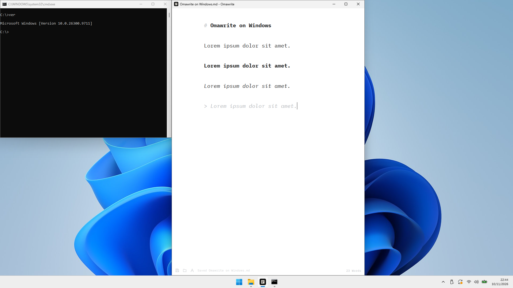
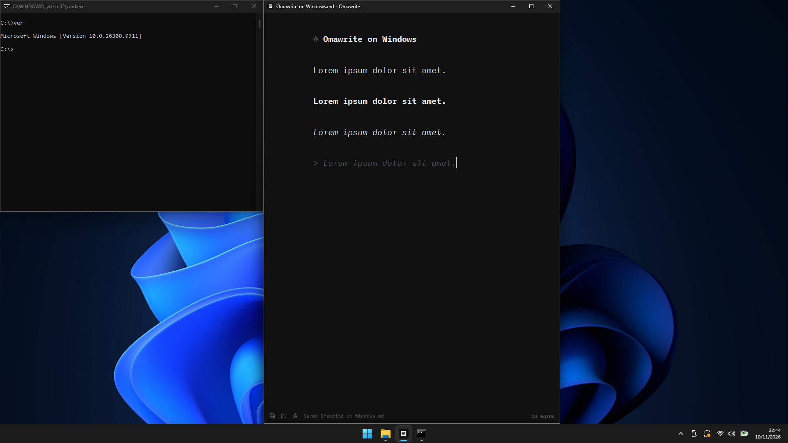

# Omawrite

Omawrite is a native Markdown editor for Windows 11 x64. It follows the system theme and is available as a portable ZIP or a per-user installer.

This fork maintains the Windows port. `omacom/omawrite` is the upstream project and the source for editor updates. Each Windows update identifies the upstream version or commit it is based on. [Upstream Omawrite](https://github.com/omacom/omawrite)

## Screenshots

Omawrite running on Windows 11 with the light and dark system themes.

### Light theme



### Dark theme



## Start on Windows

- Run the x64 Setup EXE to install Omawrite for the current user. Use **Settings > Apps > Installed apps** to uninstall it.
- Extract the x64 portable ZIP and run `omawrite.exe` to use the editor directly.

Both packages include the editor and its Qt runtime. Windows can show a reputation warning for the unsigned executables.

Download published Windows packages from this repository's **Releases** page. Build locally if a release is unavailable.

## Build on Windows

Install Visual Studio Build Tools 2022 with the C++ workload, or use an existing portable MSVC toolchain at `.tools/msvc/setup_x64.bat`. Run the build from the repository root:

```powershell
.\build-windows.cmd
```

The script reads the version from `omawrite.pro`, provisions Qt 6.8.3 and Inno Setup as needed, compiles the app, runs the Windows test suite, and writes the portable ZIP and Setup EXE to `dist/`. No arguments are needed. Find the test log in `.build/windows/tests/results.txt`.

## Upstream updates

Use your Windows fork as `origin` and `omacom/omawrite` as `upstream`. If `upstream` is missing, add it once.

```powershell
git remote add upstream https://github.com/omacom/omawrite.git
```

From the Windows branch, fetch and merge the editor updates.

```powershell
git fetch upstream --tags
git merge upstream/master
```

Preserve the Windows build and installer when resolving conflicts. In update commits or pull requests and in release notes, identify the upstream tag or commit, such as `omacom/omawrite v0.7.2`, and describe the Windows changes.

## Release verification

Keep the version metadata in `src/main.cpp`, `omawrite.pro`, and `windows/installer.iss` in sync. Open a Markdown file from the extracted ZIP and verify installation and removal with Setup on Windows. The Windows GitHub Actions workflow builds and tests both packages and generates SHA-256 files for tagged releases.

Push a `v*` tag to publish the verified packages. Tags with a prerelease suffix, such as `v0.7.2-windows.1-rc.1`, are published as GitHub prereleases and do not replace the latest stable release.

## Command line

From the folder containing `omawrite.exe`, run the following in PowerShell.

```powershell
.\omawrite.exe .\document.md
.\omawrite.exe --version | Write-Output
.\omawrite.exe --help | Write-Output
```

Run `omawrite.exe` without arguments to open an empty document.

## Shortcuts

- `Ctrl+S` saves. Unsaved documents use the system file picker.
- `Ctrl+Shift+S` saves as.
- `Ctrl+O` opens a Markdown file through the system file picker.
- `Ctrl+P` opens the system print dialog.
- `Ctrl+N` opens a new Omawrite window.
- `Ctrl+Z`, `Ctrl+Shift+Z`, and `Ctrl+Y` handle undo and redo.
- `F11` toggles fullscreen.
- `Ctrl+F` searches the document. Use `Enter` or `Ctrl+G` for the next match and `Shift+Enter` for the previous match.
- `Ctrl+H` opens find and replace.
- `Ctrl+B`, `Ctrl+I`, and `Ctrl+Shift+X` toggle bold, italic, and strikethrough Markdown. `Ctrl+K` inserts a link.
- `Ctrl+=` and `Ctrl+-` change the text size, `Ctrl+0` returns to the default. `Ctrl+scroll` does the same.
- `Ctrl+Shift+C` copies the rendered document as HTML, with plain text as a fallback.
- `Ctrl+?`, `Ctrl+/`, or `F1` shows the keyboard shortcut reference.
- In the unsaved-changes dialog, `Alt+C`, `Alt+D`, and `Alt+S` choose Cancel, Discard, and Save.

Once a document has been saved to a file, edits are auto-saved to that file a moment after you stop typing, so `Ctrl+S` is rarely needed. Untitled drafts are saved when you choose a filename. Omawrite recovers unsaved drafts after an abnormal exit. When a file changes externally, auto-save pauses until you reload, keep your version, or save. Save a recovered draft explicitly to write it to disk.

The font button in the footer picks the writing font from any installed text font, and Omawrite remembers the choice. IBM Plex Mono is the default.

Use `Ctrl+=`, `Ctrl+-`, or `Ctrl+scroll` to adjust text size from 50% to 300%. Omawrite remembers the size for new windows.

## Licensing

Omawrite is based on [omacom/omawrite](https://github.com/omacom/omawrite) and distributed under the MIT License. The source license and copyright notice are in `LICENSE`; Windows packages include them as `LICENSE-omawrite.txt`.

Omawrite dynamically links to Qt 6 under the GNU Lesser General Public License version 3. Compatible Qt DLLs can be substituted in the application directory. Windows packages include the LGPL v3 and GPL v3 texts in `licenses/`. See the [Qt source code](https://code.qt.io/cgit/qt/) and [Qt licensing information](https://www.qt.io/licensing/open-source-lgpl-obligations).

The bundled IBM Plex Mono font is copyright IBM Corp. and uses the SIL Open Font License version 1.1. The source license is in `fonts/OFL.txt`; Windows packages include it as `LICENSE-font.txt`.
